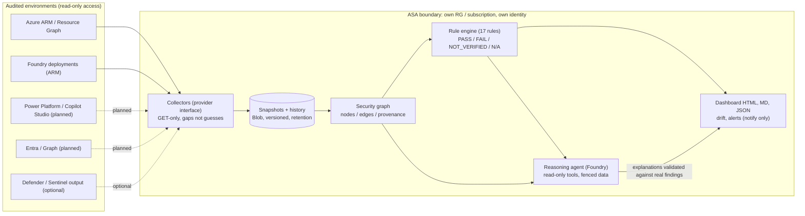

# Architecture

ASA separates **verification** (deterministic) from **explanation** (LLM). Collectors observe, the rule engine decides,
the model only explains and correlates facts it is handed through read-only tools.

## Components

* **Collectors** implement `Collector.collect() -> Snapshot`. They never raise on denied/unsupported APIs; they record a `Gap`.
  Every node/edge carries provenance: source, API, time, mode (`live` | `fixture` | `declared`).
* **Graph** node types: resource, identity, role (as edge property), endpoint, agent, model, tool, connector, datastore, action.
  Edge types: invokes, accesses, runs-as, delegates-to, reads, writes, trusts. Edge `basis`: confirmed / inferred / unknown.
* **Rules** are pure functions of a snapshot. Each result: status, severity, rule id+version, asset, scope, evidence (source/time/mode),
  context, confidence, impact, recommendation, references tagged *requirement* vs *recommendation*.
  A crashing rule yields NOT_VERIFIED. Coverage % = verified (PASS/FAIL) / applicable.
* **Agent** gets only `list_assets`, `get_findings`, `get_evidence_gaps`, `get_dependency_chains`. Environment text is sanitised and
  fenced as `UNTRUSTED_DATA`. Output citing a non-existent finding is rejected. Without cloud access `MockAgent` is used and labelled MOCK.
* **History/drift** compares fingerprints (`rule|asset`) between snapshots: new failures, resolved, verified→unverifiable.
  Alerts fire only for *new* high/critical failures, payload contains ids and severity but no evidence values.
* **Deployment boundary**: ASA runs with its own user-assigned identity holding `Reader` on explicitly listed scopes and
  write access only to its own storage container. See [permissions-matrix.md](permissions-matrix.md) and `infra/`.
* **Extensibility**: add a provider by implementing `Collector` and emitting nodes/edges/gaps (AWS/Bedrock, MCP servers, other
  agent platforms, SaaS). Rules key off node `type`/`kind` and property names, not off Azure.

## Dependency chain model (MiniBank)

`operator → Copilot Studio agent → Power Platform connector → APIM API → Function → SQL / Blob`.
Live ARM confirms APIM→Function (serviceUrl == function host), Function→managed identity, identity→storage (role assignments).
Copilot Studio / connector / Dataverse hops are *declared from design docs* and labelled `inferred`/`unknown` until a Power Platform collector exists.
